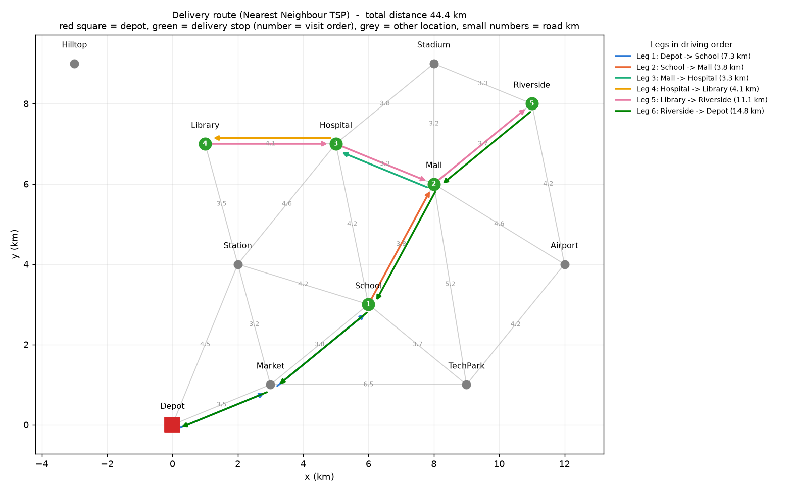
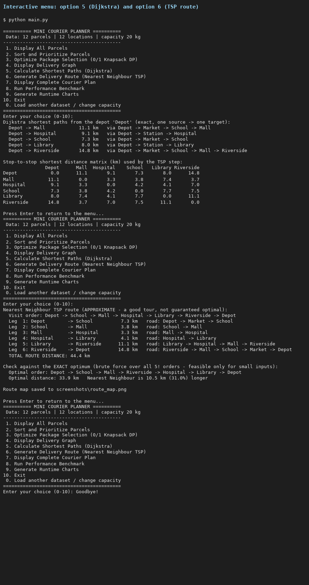
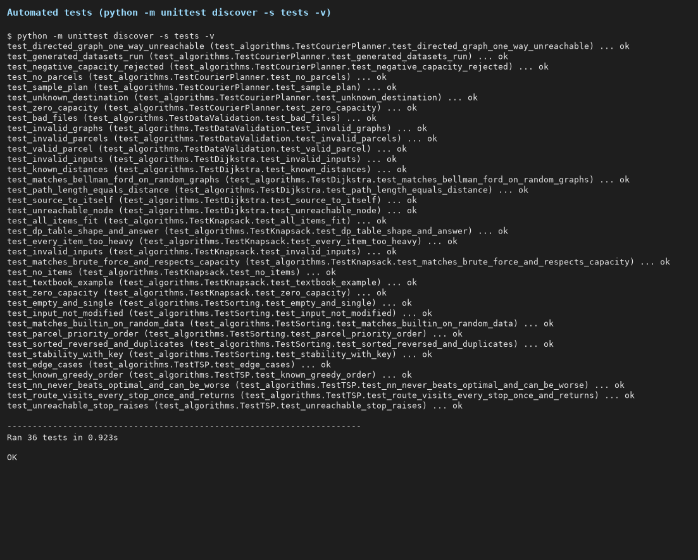
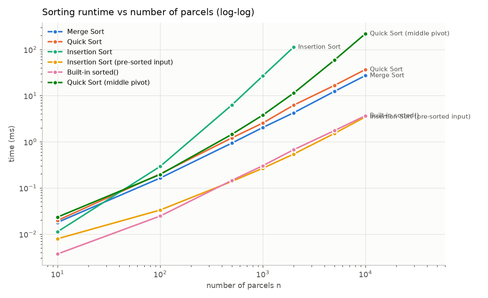
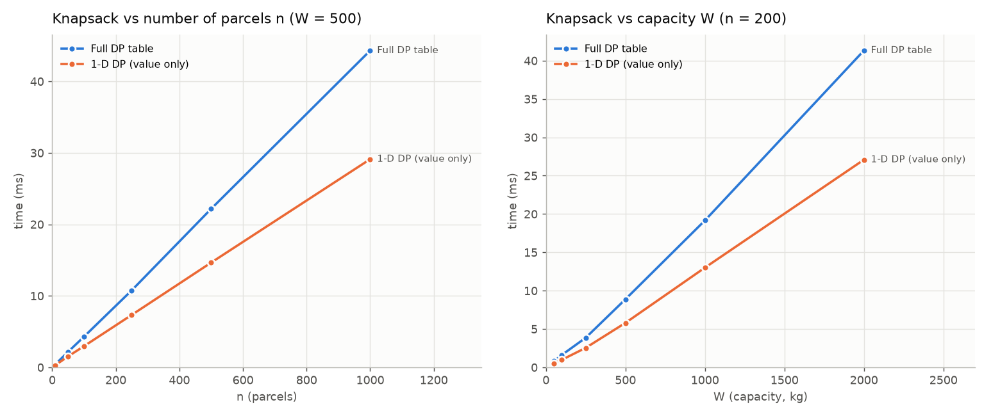
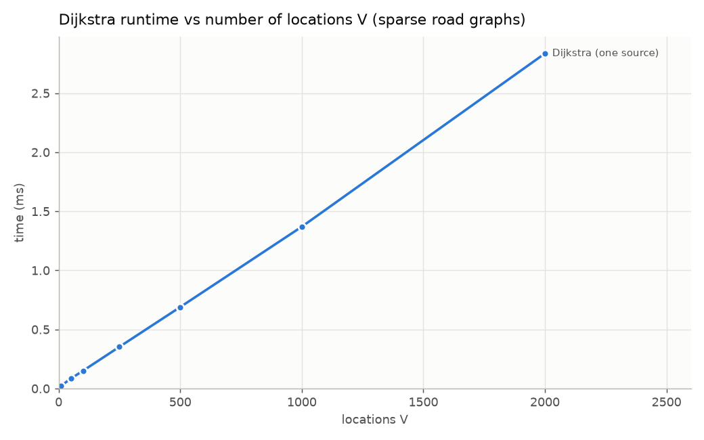
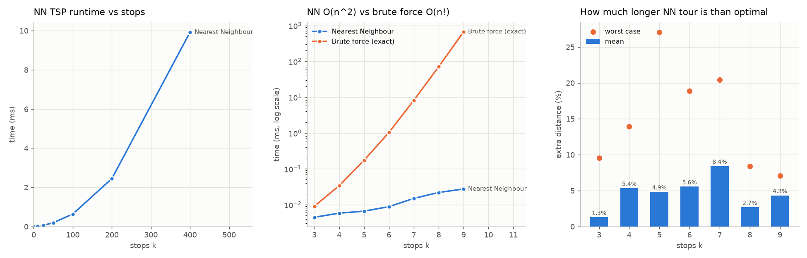
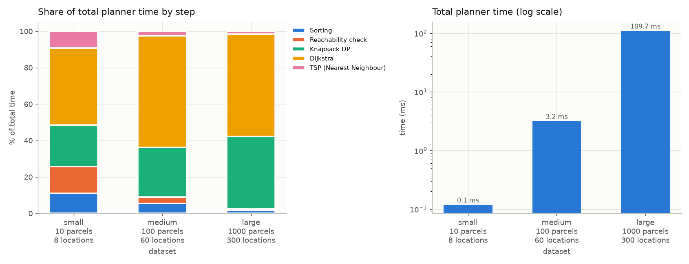

<div align="center">

# K.R. Mangalam University, Gurugram, Haryana

## Capstone Assignment Report

# Mini-Courier Planner
### An integrated courier planning system using Sorting, Dynamic Programming, Graph Algorithms and Approximation

**Course:** Design & Analysis of Algorithms (ETCCDA302)
**Programme & Semester:** B.Tech CSE & Specializations, Semester: `[SEMESTER]`
**Faculty:** Dr. Shweta Agarwal

| | |
|---|---|
| Student name | `[STUDENT NAME]` |
| Roll number | `[ROLL NUMBER]` |
| Section / Group | `[SECTION]` |
| Submission date | `[SUBMISSION DATE]` |
| GitHub repository | `[REPOSITORY LINK, if submitting via GitHub]` |

</div>

---

## Table of contents

1. Introduction
2. Problem statement
3. Objectives
4. System requirements
5. System architecture
6. Algorithms used
7. Algorithm explanations
8. Implementation details
9. Sample datasets
10. Output screenshots / evidence
11. Testing methodology
12. Runtime analysis and charts
13. Time and space complexity
14. Results and discussion
15. Limitations
16. Future improvements
17. Conclusion
18. References

Appendices: A. Execution instructions · B. Requirement checklist · C. Demonstration guide · D. Viva questions

---

## 1. Introduction

A courier company has to make three decisions every day: which parcels are most urgent,
which ones fit in the van, and in what order to drive to the customers. Each decision is
a classic algorithmic problem. Prioritising parcels is **sorting**. Filling the van is the
**0/1 knapsack** problem, solved with **dynamic programming**. Distances between places
are **shortest paths**, solved with **Dijkstra's algorithm**. The visiting order is the
**Travelling Salesman Problem (TSP)**, approximated with the **Nearest Neighbour** heuristic.

This project connects all four algorithms into one working Python application, the
*Mini-Courier Planner*. It also measures how each algorithm performs as the input grows.

## 2. Problem statement

*Given a list of parcels and delivery points, generate an ordered delivery route and an
optimised packing plan.* Each parcel has an id, an integer weight (kg), a priority (1 to 5),
a deadline (hours) and a destination. The road network is a weighted graph whose edge
weights are road distances in km. One van with a fixed capacity starts and ends at the
depot. The system must:

* prioritise the parcels,
* choose the most valuable set of parcels that fits in the van,
* compute the exact shortest road distances,
* produce a short tour through all chosen destinations, with the total distance, and
* report how long every step takes on small, medium and large inputs.

## 3. Objectives

1. Sort parcels by deadline, then priority, with a suitable O(n log n) stable sort.
2. Choose the best parcel set with 0/1 Knapsack DP and show the DP table.
3. Represent the delivery area as a weighted graph and compute shortest paths with Dijkstra.
4. Build the delivery sequence with Nearest Neighbour TSP and calculate the total distance.
5. Handle invalid input and edge cases (unknown or unreachable destinations, zero capacity, empty data).
6. Benchmark every algorithm on growing inputs and plot the results with Matplotlib.
7. Document, test and demonstrate the system.

## 4. System requirements

| Item | Requirement |
|---|---|
| Language | Python 3.8 or later (developed and tested with Python 3.14.2) |
| Libraries | Standard library only for the algorithms. **Matplotlib** for charts and the route map (`pip install -r requirements.txt`) |
| OS | Any OS that runs Python (tested on Windows 11) |
| Hardware | Any normal laptop. The full benchmark takes about 1 minute |
| External services | None. Everything runs offline |

## 5. System architecture

The system has three layers. **`algorithms/`** holds pure, independently testable
functions. **`modules/`** holds the parcel, route and pipeline logic. **`main.py`** is the
command-line interface. Benchmarks and tests sit beside these layers. Full design notes,
including the data structures and the reasons behind each decision, are in
[`system_design.md`](system_design.md).

```
main.py (menu / --demo / --benchmark)
   └── modules/courier_planner.py ── runs and times the pipeline
         ├── modules/parcel_manager.py ── load/validate, sort, knapsack
         └── modules/route_manager.py  ── graph, reachability, Dijkstra matrix, TSP, map
               └── algorithms/ sorting.py · knapsack.py · dijkstra.py · tsp.py
```

**Workflow:**


## 6. Algorithms used

| Phase | Problem | Algorithm | Type | Exact? |
|---|---|---|---|---|
| 2 | Prioritise parcels | **Merge Sort** (plus Quick and Insertion Sort for comparison) | Divide and conquer | Yes |
| 2 | Box filling | **0/1 Knapsack** | Dynamic programming | Yes (optimal) |
| 3 | Shortest path between two places | **Dijkstra** with a binary heap | Greedy | Yes |
| 3 | Overall visiting order | **Nearest Neighbour TSP** | Greedy heuristic | **No**, approximate |
| 3/4 | Verify the TSP quality | Brute-force TSP | Exhaustive search | Yes, small inputs only |

## 7. Algorithm explanations

The detailed pseudocode, hand traces on the sample data and proofs of behaviour are in
[`algorithm_analysis.md`](algorithm_analysis.md). In short:

* **Merge Sort** splits the list in half, sorts each half and merges them. The merge takes
  from the left half on equal keys, which makes the sort *stable*. The key is
  `(deadline, priority, id)`.
* **0/1 Knapsack DP**: `dp[i][c] = max(dp[i-1][c], dp[i-1][c-w_i] + v_i)`. The answer is
  `dp[n][W]`, and backtracking through the table recovers the chosen parcels. The parcel
  value is `(6 - priority) * 10 + max(0, 24 - deadline)`.
* **Dijkstra** repeatedly removes the closest unvisited node from a min-heap and relaxes its
  edges. A predecessor map rebuilds the actual road path. Unreachable nodes keep distance infinity.
* **Nearest Neighbour TSP** starts at the depot, always drives to the closest unvisited
  stop (using the Dijkstra distances), and finally returns to the depot. It runs in O(k^2).
  It is fast but **not guaranteed optimal**.

## 8. Implementation details

| File | Contents |
|---|---|
| `algorithms/sorting.py` | `merge_sort`, `quick_sort` (random pivot), `quick_sort_middle_pivot` (for the benchmark), `insertion_sort`. Each takes a `key` and returns a new list |
| `algorithms/knapsack.py` | `knapsack_01` (full table and backtracking), `knapsack_max_value_1d` (O(W) memory), `format_dp_table`, input validation |
| `algorithms/dijkstra.py` | `dijkstra` (heapq), `reconstruct_path`, `shortest_path`, `validate_graph` |
| `algorithms/tsp.py` | `nearest_neighbor_tsp`, `brute_force_tsp`, `route_length` |
| `modules/parcel_manager.py` | `Parcel` dataclass, JSON loading and validation, `priority_key`, `sort_parcels`, `select_parcels`, table printing |
| `modules/route_manager.py` | `DeliveryGraph`, graph validation, `split_reachable`, `compute_shortest_paths`, `plan_route`, `plot_route` |
| `modules/courier_planner.py` | `CourierPlanner.run()`: the whole pipeline with per-step `perf_counter` timings, ETA, deadline check, and the optimum check for 8 stops or fewer; text reports |
| `main.py` | Menu with options 1 to 10 (plus 0 to load data), and the `--demo`, `--benchmark`, `--parcels`, `--graph` and `--capacity` options |
| `performance/benchmarking.py` | All Phase 4 measurements, tables and charts |
| `data/generate_datasets.py` | Seeded generator for the small, medium and large datasets |
| `tests/test_algorithms.py` | 36 unit and integration tests |
| `tools/capture_evidence.py` | Runs the program and saves its real output as `.txt` and `.png` evidence |

**Error handling:** invalid JSON, missing fields, wrong types, non-positive weights or
deadlines, priorities outside 1 to 5, duplicate ids, negative road lengths, unknown nodes in
edges, a missing depot, negative capacity, invalid menu choices and missing files all
produce a clear message instead of a crash (`screenshots/08_invalid_inputs.txt`).

## 9. Sample datasets

| Dataset | File(s) | Parcels | Locations | Roads | Capacity |
|---|---|---:|---:|---:|---:|
| Sample (hand-made) | `data/parcels.json`, `data/delivery_graph.json` | 12 | 12 | 21 | 20 kg |
| Small (generated) | `data/test_datasets/small_*.json` | 10 | 8 | 17 | 20 kg |
| Medium (generated) | `data/test_datasets/medium_*.json` | 100 | 60 | 127 | 100 kg |
| Large (generated) | `data/test_datasets/large_*.json` | 1000 | 300 | 609 | 500 kg |

The sample data includes a deliberately **isolated location (Hilltop)**, so it shows how
unreachable destinations are handled. The generated graphs are always connected (each node
is linked to its 3 nearest neighbours, plus a spanning-tree link). They use a fixed random
seed, so anyone can reproduce them with `python data/generate_datasets.py`.

**Sample input (excerpt) and output:**

```
P04  5 kg  priority 1  deadline 3 h  -> Mall         value 71
P10  9 kg  priority 1  deadline 6 h  -> Station      value 68
P12  4 kg  priority 1  deadline 2 h  -> Hilltop      value 72
... (12 parcels, capacity 20 kg)

Selected: P04, P01, P06, P03, P08, P11   19 kg, value 308
Undeliverable: P12 (Hilltop unreachable)
Route: Depot -> School -> Mall -> Hospital -> Library -> Riverside -> Depot = 44.4 km
```

## 10. Output screenshots / evidence

All evidence was produced by `python tools/capture_evidence.py`, which actually runs the
program. Each `.png` shows exactly the text in the `.txt` file next to it.

| # | Evidence | Files |
|---|---|---|
| 1 | Complete plan on the sample data (all steps, DP table, route, summary, timings) | `screenshots/01_complete_plan_sample.{txt,png}` |
| 2 | Menu options 1, 2 (before/after sorting), 4 (graph), and an invalid choice | `screenshots/02_menu_session.{txt,png}` |
| 3 | Menu options 5 (Dijkstra) and 6 (NN route plus the optimum check) | `screenshots/03_menu_dijkstra_tsp.{txt,png}` |
| 4 | 36 automated tests, all passing | `screenshots/04_unit_tests.{txt,png}` |
| 5 | Unseen medium dataset (100 parcels) | `screenshots/05_medium_dataset_plan.{txt,png}`, `route_map_medium.png` |
| 6 | Capacity changed to 35 kg | `screenshots/06_capacity_override.{txt,png}` |
| 7 | Zero capacity | `screenshots/07_zero_capacity.{txt,png}` |
| 8 | Invalid inputs | `screenshots/08_invalid_inputs.{txt,png}` |
| 9 | Benchmark run log | `screenshots/09_benchmark_run.{txt,png}` |

**Route map of the sample plan:**



**Dijkstra and Nearest Neighbour output from the menu:**



**Test results:**



> Note for submission: these images are rendered from captured console output. If your
> faculty asks for actual window screenshots, run `python main.py`, choose each option and
> press Win+Shift+S. Put those images in `screenshots/` as well.

## 11. Testing methodology

1. **Unit tests per algorithm** (`python -m unittest discover -s tests -v`, 36 tests, all pass):
   * Sorting: empty, single, sorted, reversed and duplicate inputs, 50 random lists checked
     against `sorted()`, stability, and the input list left unchanged.
   * Knapsack: a textbook example, 150 random cases checked against brute-force subset
     enumeration, capacity never exceeded, 1-D version agrees with the full table, zero
     capacity, no items, all items too heavy, invalid types.
   * Dijkstra: hand-checked distances, path length equals the reported distance, an
     unreachable node, a source to itself, 40 random graphs checked against an independent
     Bellman-Ford, negative weights rejected.
   * TSP: every stop visited once, the tour returns to the depot, a hand-checked greedy
     order, NN never shorter than the optimum and **sometimes longer** (proves it is an
     approximation), an empty stop list, an unreachable stop.
2. **Validation tests**: every bad-data case listed in Section 8.
3. **Integration tests**: the full planner on the sample data, checked against hand-computed
   values (value 308, Depot to Mall 11.1 km, route 44.4 km, optimum 33.9 km). Also zero
   capacity, no parcels, unknown destination, a one-way graph, and all three generated datasets.
4. **Performance tests**: Section 12.

## 12. Runtime analysis and charts

Method: `time.perf_counter()`, the minimum of 3 to 15 repeats, with garbage collection
paused during timing (as `timeit` does). Inputs come from a fixed random seed. Full tables
are in `performance/results/runtime_tables.md`.

**Sorting.** Merge Sort grows as n log n. Insertion Sort grows as n^2. Quick Sort with a
middle pivot degraded on our data.



**Knapsack.** The time is linear in n and linear in W, which confirms O(nW).



**Dijkstra.** The time is almost linear in V on sparse road graphs.



**TSP.** NN is quadratic but tiny. Brute force explodes factorially. NN tour quality is shown on the right.



**End-to-end.** The share of each step, and the total time per dataset.



| Dataset | Parcels | Locations | Selected | Stops | Route | Sort | Knapsack | Dijkstra | NN TSP | **Total** |
|---|---:|---:|---:|---:|---:|---:|---:|---:|---:|---:|
| small | 10 | 8 | 5 | 3 | 305.6 km | 0.012 ms | 0.026 ms | 0.048 ms | 0.010 ms | **0.12 ms** |
| medium | 100 | 60 | 27 | 23 | 610.5 km | 0.159 ms | 0.800 ms | 1.799 ms | 0.076 ms | **3.2 ms** |
| large | 1000 | 300 | 194 | 139 | 1605.9 km | 2.022 ms | 43.0 ms | 60.6 ms | 1.807 ms | **110 ms** |

## 13. Time and space complexity

| Algorithm | Best | Average | Worst | Space |
|---|---|---|---|---|
| Merge Sort | O(n log n) | O(n log n) | O(n log n) | O(n) |
| Quick Sort (random pivot) | O(n log n) | O(n log n) | O(n^2) | O(n) here |
| Insertion Sort | O(n) | O(n^2) | O(n^2) | O(1)* |
| 0/1 Knapsack DP | O(nW) | O(nW) | O(nW) | O(nW) (1-D version: O(W)) |
| Dijkstra (binary heap) | O((V+E) log V) | same | same | O(V + E) |
| Dijkstra from k stops | O(k (V+E) log V) | same | same | O(kV) |
| Nearest Neighbour TSP | O(k^2) | O(k^2) | O(k^2) | O(k) |
| Brute-force TSP | O(k! k) | same | same | O(k) |
| **Whole planner** | O(n log n + nW + k(V+E) log V + k^2) | | | O(nW + kV + E) |

\*Our version stores the keys in a separate list (O(n)) so that it can sort by key.

## 14. Results and discussion

* **The packing is optimal, and better than greedy.** On the sample, the DP loads 19 of
  20 kg for a value of 308. A "most urgent first" greedy load gets only 268. The DP
  correctly leaves the heavy Critical parcel P10 (9 kg) for the next trip, because three
  lighter parcels give more total value.
* **Undeliverable parcels are caught.** P12 (Hilltop, no roads) is reported, never loaded.
* **Dijkstra distances are exact.** They match a hand trace and an independent
  Bellman-Ford check.
* **Nearest Neighbour is fast but approximate.** On the sample it gives 44.4 km against an
  optimum of 33.9 km (31% longer), because a short greedy step (Mall to Hospital, 3.3 km)
  left Riverside stranded. With a 35 kg capacity it found the optimal tour (38.5 km). On
  110 random instances it averaged 1.3% to 8.4% longer than optimal, and 27.1% longer at worst.
* **Scaling matches the theory.** Merge Sort: 10 times the parcels took 13.4 times as long
  (n log n predicts 13.3). Insertion Sort: 4 times the parcels took 18 times as long (n^2).
  Knapsack: linear in n and in W. NN: 4 times the stops took 15.5 times as long (k^2). Brute
  force: 8 to 9 stops took 9.5 times as long (k!).
* **Pivot choice matters.** Quick Sort with a middle pivot was 8 times slower than Merge Sort
  at n = 10,000 (recursion depth 286). A random pivot fixed it.
* **Where the time goes.** For large inputs, Dijkstra (once per stop) and the knapsack use
  94% of the time. The large plan (1000 parcels) still takes only about 0.1 s.

## 15. Limitations

1. **The route ignores deadlines.** NN minimises distance only. The medium dataset has 12
   parcels that arrive after their deadline. They are flagged as LATE, but the route is not
   reordered to avoid this.
2. **One van and one trip.** Parcels left behind are listed, but no second trip is planned.
3. **Nearest Neighbour is not optimal.** The exact check works only up to 8 stops.
4. **Integer weights only.** This is required by the DP table. Decimal weights must be scaled.
5. **Fixed average speed** (30 km/h) for ETAs. There is no traffic or time-of-day model.
6. **Python constant factors.** Pure-Python sorts are about 7 times slower than the built-in Timsort.

## 16. Future improvements

1. 2-opt or Or-opt improvement of the NN tour, Held-Karp DP for up to about 15 stops, Christofides for a 1.5 guarantee.
2. TSP with time windows (deadline-aware routing), and planning multiple vans/trips (vehicle routing problem).
3. Faster distances: A* search, early-stopping Dijkstra, cached all-pairs distances for a fixed map.
4. Knapsack: a 1-D table with a "taken" bitset, NumPy vectorisation, weight scaling, branch-and-bound.
5. A web or GUI front end with an interactive map, and loading real map data (e.g. OpenStreetMap extracts).

## 17. Conclusion

The Mini-Courier Planner shows how four classic algorithm families solve one realistic
problem together. Sorting orders the work. Dynamic programming finds a provably optimal
load. Dijkstra gives exact road distances. A greedy approximation produces a good delivery
order quickly. Every algorithm is implemented from scratch in Python and tested against
independent reference implementations. The benchmarks confirm the expected complexities
and show which steps would need optimising for very large inputs. The project also shows
clearly that an exact answer (Dijkstra, the knapsack) and an approximate answer (Nearest
Neighbour TSP) are different, and why that trade-off is acceptable.

## 18. References

1. T. H. Cormen, C. E. Leiserson, R. L. Rivest, C. Stein, *Introduction to Algorithms*, 4th ed., MIT Press, 2022. Chapters on sorting, dynamic programming, single-source shortest paths, and approximation algorithms.
2. J. Kleinberg, É. Tardos, *Algorithm Design*, Pearson, 2006. Knapsack (Section 6.4), Dijkstra (Section 4.4).
3. E. W. Dijkstra, "A note on two problems in connexion with graphs," *Numerische Mathematik* 1, 269–271, 1959.
4. D. J. Rosenkrantz, R. E. Stearns, P. M. Lewis, "An analysis of several heuristics for the traveling salesman problem," *SIAM J. Computing* 6(3), 1977.
5. Python Software Foundation, *Python 3 documentation*: `heapq`, `time.perf_counter`, `timeit`. https://docs.python.org/3/
6. J. D. Hunter, "Matplotlib: A 2D graphics environment," *Computing in Science & Engineering* 9(3), 2007.
7. Course material: Design & Analysis of Algorithms (ETCCDA302), lab assessments 1–4, K.R. Mangalam University.

---

## Appendix A: Execution instructions

See [`../README.md`](../README.md). Short version:

```
pip install -r requirements.txt
python main.py                 # menu
python main.py --demo          # complete plan in one go
python -m unittest discover -s tests -v
python main.py --benchmark     # tables + charts
```

## Appendix B: Requirement checklist

See [`requirements_checklist.md`](requirements_checklist.md).

## Appendix C: Demonstration guide

See [`demonstration_guide.md`](demonstration_guide.md).

## Appendix D: Viva questions

See [`viva_questions.md`](viva_questions.md).
