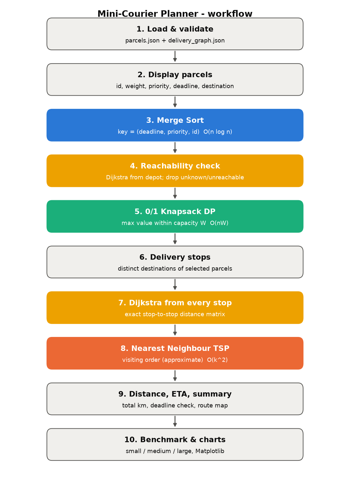
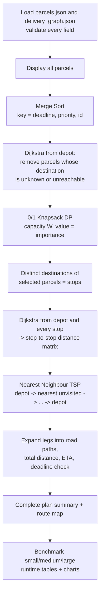

# Phase 1: Courier Problem Design and Planning

## 1. Problem definition

A courier company has one van at a **depot**. It has a list of **parcels**, and each parcel
has a weight, a priority, a deadline and a destination. The van can carry only a limited
weight (its **capacity**). For one delivery trip the system must decide:

1. **Which parcels are most urgent?** Put the parcels in priority order.
2. **Which parcels go in the van?** Choose the set of parcels that gives the greatest total
   delivery importance without going over the weight capacity.
3. **How far apart are the stops?** Find the shortest road distance between the depot and
   each destination, and between every pair of destinations.
4. **In what order should the van visit the stops?** Find a short tour that starts at the
   depot, visits every destination once and returns to the depot.
5. **How long is the trip, and how fast is the system?** Report the total route distance,
   an arrival time per stop, and the running time of each algorithm.

## 2. Objectives

| # | Objective | How it is met |
|---|---|---|
| O1 | Prioritise parcels by deadline and priority | Merge Sort on the key (deadline, priority, id) |
| O2 | Load the most valuable set of parcels without exceeding capacity | 0/1 Knapsack with Dynamic Programming |
| O3 | Exact shortest road distances | Dijkstra's algorithm (binary heap) |
| O4 | A short visiting order for all stops | Nearest Neighbour TSP heuristic |
| O5 | Total route distance and arrival times | Sum of leg distances, ETA = distance / speed |
| O6 | Measure and compare performance | `time.perf_counter`, small/medium/large datasets, Matplotlib charts |
| O7 | Robustness | Input validation, unreachable/unknown destinations, zero capacity, empty data |

## 3. Data design

### 3.1 Parcel attributes (`data/parcels.json`)

| Field | Type | Rule | Meaning |
|---|---|---|---|
| `id` | text | unique, not empty | Parcel identifier, e.g. `P01` |
| `weight` | integer | > 0 | Weight in kg. It must be an integer because the knapsack DP uses weight as a table index |
| `priority` | integer | 1 to 5 | 1 = Critical, 2 = High, 3 = Medium, 4 = Normal, 5 = Low |
| `deadline` | integer | > 0 | Hours after dispatch by which the parcel must arrive |
| `destination` | text | a graph node | Where the parcel goes |

The file also holds `vehicle_capacity_kg` (a non-negative integer).

**Derived value (delivery importance) used by the knapsack:**

```
value = (6 - priority) * 10  +  max(0, 24 - deadline)
```

A Critical parcel scores 50 points and a Low parcel scores 10. A parcel due within 24 hours
gets up to 24 extra urgency points. *Design decision:* the assignment does not say what
the knapsack should maximise. Using one score built from both priority and deadline
means the DP prefers parcels that are both important and urgent, and the score is easy to
explain and to change.

### 3.2 Delivery points and graph (`data/delivery_graph.json`)

```json
{
  "depot": "Depot",
  "directed": false,
  "nodes": { "Depot": {"x": 0, "y": 0}, "Market": {"x": 3, "y": 1}, "...": {} },
  "edges": [ ["Depot", "Market", 3.5], ["Depot", "Station", 4.5], "..." ]
}
```

* **Nodes** are delivery locations (the depot plus customer areas). The `x`, `y`
  coordinates are used only for drawing the route map.
* **Edges** are roads, written as `[from, to, distance_km]`. The weight must be
  **non-negative**, because Dijkstra's algorithm is only correct for non-negative weights.
* `directed: false` means every road works both ways. If you set `directed: true`, roads
  become one-way and the planner also checks that the van can get back to the depot.

### 3.3 Data structures

| Structure | Where | Why |
|---|---|---|
| `Parcel` frozen dataclass | `parcel_manager.py` | Named fields and immutability: a parcel cannot be changed by accident while it moves through the pipeline |
| Python `list` | parcels, routes | Ordered sequence, O(1) index access (the DP needs `weights[i]`) |
| 2-D list `dp[n+1][W+1]` | `knapsack.py` | The DP table. Kept so it can be displayed and backtracked |
| Adjacency list `dict[node] -> dict[neighbour] -> km` | `route_manager.py` | Road networks are **sparse**, so this needs O(V+E) memory instead of O(V^2) for a matrix. Dijkstra only looks at real neighbours |
| Binary min-heap (`heapq`) | `dijkstra.py` | Gives the closest unvisited node in O(log V) |
| Distance matrix `dict[a][b]` | `ShortestPathTable` | Dijkstra distances between every pair of stops (the "metric closure"). The TSP looks these up in O(1) |
| Predecessor map `prev[node]` | `dijkstra.py` | Rebuilds the actual road path for each leg |

## 4. Algorithm selection

| Task | Chosen algorithm | Why this one | Alternatives considered |
|---|---|---|---|
| Prioritise parcels | **Merge Sort** | Its worst case is O(n log n), it is **stable** (parcels with equal keys keep the order they arrived in, which is fair), and its speed does not depend on the input order | Quick Sort: O(n^2) worst case and sensitive to the pivot (we measured this). Insertion Sort: O(n^2), good only for tiny or nearly sorted lists. Heap Sort: not stable |
| Select parcels | **0/1 Knapsack with DP** | Parcels cannot be split (0/1). Greedy by value/weight is **not optimal** for 0/1 knapsack. DP is exact in O(nW) | Brute force O(2^n). Greedy is fast but can be wrong. Fractional knapsack does not apply because parcels are indivisible |
| Distance between two places | **Dijkstra (binary heap)** | Exact shortest paths when weights are non-negative, O((V+E) log V) | Bellman-Ford O(VE), needed only for negative weights. Floyd-Warshall O(V^3), all pairs, too slow for large V. BFS works only on unweighted graphs |
| Order of visiting all stops | **Nearest Neighbour heuristic** | TSP is NP-hard. NN takes O(k^2), is easy to explain and usually gives a reasonable tour | Brute force O(k!) is exact but only feasible for about 10 stops (we use it to **check** NN). Held-Karp DP O(k^2 2^k). 2-opt improvement (suggested as future work) |

> **Important distinction.** Dijkstra answers *"what is the shortest path between two places?"*,
> and its answer is **exact**. The TSP heuristic answers *"in what order should all the stops
> be visited?"*, and its answer is **approximate**. Nearest Neighbour does not always find the
> best tour. In the sample data it is 31% longer than the optimum (see Section 7).

## 5. System architecture

```
+--------------------------------------------------------------------------+
|                         main.py  (CLI menu, --demo)                      |
+--------------------------------------------------------------------------+
|                 modules/courier_planner.py  (pipeline + timings)         |
|  +---------------------------+      +---------------------------------+  |
|  | modules/parcel_manager.py |      | modules/route_manager.py        |  |
|  |  load/validate parcels    |      |  load/validate graph            |  |
|  |  sort_parcels()           |      |  reachability, distance matrix  |  |
|  |  select_parcels()         |      |  plan_route(), plot_route()     |  |
|  +-------------+-------------+      +----------------+----------------+  |
+----------------|-------------------------------------|-------------------+
|  algorithms/ (pure functions, no I/O, independently testable)            |
|   sorting.py      knapsack.py         dijkstra.py         tsp.py         |
|   merge/quick/    knapsack_01,        dijkstra,           nearest_       |
|   insertion       1-D version,        reconstruct_path    neighbor_tsp,  |
|                   format_dp_table                         brute_force    |
+--------------------------------------------------------------------------+
|  data/*.json   performance/benchmarking.py   tests/test_algorithms.py    |
+--------------------------------------------------------------------------+
```

The layers depend only on the layers below them. The `algorithms` package does not
know about parcels or files: it works on plain lists and dictionaries. That keeps each
algorithm independently testable and reusable.

## 6. Workflow diagram



The same workflow in Mermaid notation (rendered automatically on GitHub):



Text version (for printing):

```
 load+validate -> display -> SORT (merge) -> reachability (Dijkstra)
   -> KNAPSACK (DP) -> stops -> DIJKSTRA (all stops) -> NN TSP
   -> total distance + ETA -> summary/map -> BENCHMARK + CHARTS
```

## 7. How the algorithms work together, on the sample data

The values below come from a real run of `python main.py --demo`
(full output: `screenshots/01_complete_plan_sample.txt`).

**Sample input:** 12 parcels (58 kg in total), capacity 20 kg, 12 locations, 21 roads.
`Hilltop` has no roads.

| Step | Output |
|---|---|
| Sort | `P12 (2 h), P04 (3 h), P01 (4 h), P06 (5 h), P10 (6 h, priority 1), P02 (6 h, priority 2), P03, P09, P08, P05, P11, P07` |
| Reachability | `P12 -> Hilltop` is **undeliverable** (no road). It is removed before packing |
| Knapsack | Selects `P04, P01, P06, P03, P08, P11` = **19 kg, value 308** (best possible) |
| Stops | Mall, Hospital, School, Library, Riverside |
| Dijkstra | Depot to Mall is 11.1 km via Market and School; Depot to Riverside is 14.8 km |
| NN TSP | `Depot -> School -> Mall -> Hospital -> Library -> Riverside -> Depot` = **44.4 km** |
| Check | The exact optimum (brute force over 5! = 120 orders) is 33.9 km, so NN is 31% longer |
| ETA | Every selected parcel arrives before its deadline (the latest is Riverside at 0.99 h) |

**Why the knapsack leaves P10 (Critical, 9 kg) behind:** P10 would use 45% of the van for
68 points. P03 + P08 + P11 together weigh 8 kg and score 108 points. The DP compares every
combination and proves that 308 is the best possible total. This is the kind of trade-off
a greedy "most urgent first" rule cannot make. P10 goes on the next trip.

## 8. Design decisions for ambiguous requirements

| Ambiguity | Decision |
|---|---|
| "Deadlines **or** priority" | Both are used: deadline first, then priority, then id |
| What the knapsack maximises | The importance score defined in Section 3.1 |
| Parcels the van cannot reach | Removed **before** the knapsack, so no capacity is wasted, and reported as undeliverable |
| Several parcels for the same place | One stop. All its parcels are delivered there |
| Does the van return to the depot? | Yes, the route is a closed tour (the standard TSP) |
| Arrival times | Assume an average speed of 30 km/h (`DEFAULT_SPEED_KMH`). Late parcels are flagged, not reordered |
| Benchmark timing | Minimum of 3 to 15 repeats, with garbage collection paused, the same method `timeit` uses |
